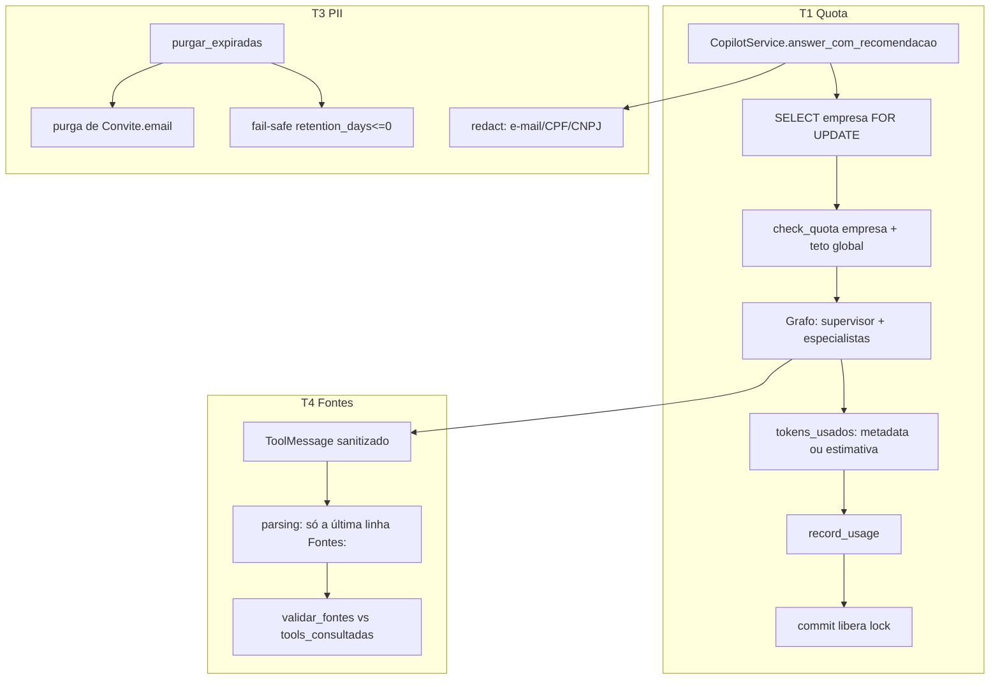

# Segurança Sweep — Design

**Spec**: `docs/specs/features/seguranca-sweep/spec.md`
**Status**: Awaiting human approval

---

## Architecture Overview

Épico transversal sem módulo novo: mexe em pontos existentes nas três fronteiras
(`agents` — contagem/sanitização; `libs` — metering, repositórios, models,
config; `apps` — rotas de cadastro/convite, auth). Nenhuma tool nova no grafo; o
grafo continua read-only (AD-002). Cada task é um PR contra a branch de integração
`feat/seguranca-sweep`, cortado do head da integração — por isso as 4 migrações
encadeiam linearmente (§Migrações).



## Code Reuse Analysis

| Component | Location | How to Use |
| --- | --- | --- |
| `check_quota`/`record_usage`/`QuotaExcedida` | `copilot/metering.py` | Estendidos: quota por empresa, lock, teto global — mesma exceção pública |
| `AgentState.tokens_usados` (reducer `operator.add`) | `state.py` | Já existe: supervisor passa a contribuir; `tools_consultadas` replica o padrão |
| `registrar_evento` + categorias de PII | `audit/` | `redacao.categorias` cresce; auditoria do turno não muda de shape |
| `RateLimiter`/`limitar` | `web/rate_limit.py` | Reuso direto: `Depends(limitar("cadastro"))` em `POST /cadastro` |
| Padrão fail-fast de migração com lista de conflitos | decisões humanas 4 | Mesmo mecanismo nas Tasks 2 e 5 |
| `begin_nested` (SAVEPOINT) | `repositories/conversations.py` | Corrida do `get_or_create` (Task 5); padrão válido nos dois dialetos |
| `FakeChatModel` (filas `routes`/`tool_calls`) | `tests/conftest.py` | Estendido para `include_raw`; nenhum teste toca rede |

---

## Task 1 — Quota/Metering (C-1, I-7, I-8)

### Contagem do supervisor (QUO-01)

`create_supervisor_node` (`agents/supervisor.py`) hoje devolve só `{"next": route}`.
O roteador passa a ser criado com `include_raw=True`:

```python
router = model.with_structured_output(RouteDecision, include_raw=True)
```

`router.invoke(...)` devolve `{"raw": AIMessage, "parsed": RouteDecision,
"parsing_error": ...}`; o nó extrai `parsed` (malformado → `FINISH`, como hoje) e
conta tokens do `raw`:

```python
def node(state: AgentState) -> dict[str, Route | int]:
    retorno = router.invoke([SystemMessage(content=system_prompt), *mensagens])
    tokens = tokens_da_mensagem(retorno.get("raw"))
    ...
    return {"next": route, "tokens_usados": tokens}
```

O reducer `operator.add` já existente em `state.py` soma o fragmento do supervisor
aos dos especialistas — nenhuma mudança de schema de estado aqui.

### Tokens: metadata ausente → estimativa (QUO-02)

`_tokens_da_resposta` (`agents/base.py:31-36`) vira helper público compartilhado
por supervisor e especialistas:

```python
def tokens_da_mensagem(mensagem: BaseMessage | None) -> int:
    """Tokens reportados pela mensagem; sem metadata, estimativa conservadora."""
    uso = getattr(mensagem, "usage_metadata", None)
    if isinstance(uso, Mapping) and int(uso.get("total_tokens") or 0) > 0:
        return int(uso["total_tokens"])
    conteudo = str(getattr(mensagem, "content", "") or "")
    return max(1, len(conteudo) // 4)
```

**Shape da estimativa** (decisão humana 7): `max(1, len(texto) // 4)` por mensagem —
~4 chars/token, piso 1 garante "nunca 0" inclusive para mensagens com conteúdo
vazio (a meta é não subestimar; sobrestimar 1 token por mensagem vazia é
conservador). `max_tool_steps` limita o loop ReAct, então a soma por turno é
finita.

### Serialização da quota (QUO-03) — FOR UPDATE, não contador atômico

**Escolha: lock pessimista de linha na `Empresa`, mantido do check ao commit.**

```python
# copilot/metering.py
def quota_da_empresa(empresa: Empresa, settings: Settings) -> int:
    """Quota da empresa; NULL cai para o teto global do settings."""
    if empresa.token_quota_mensal is not None:
        return empresa.token_quota_mensal
    return settings.llm_monthly_token_quota

def travar_empresa(session: Session, empresa_id: UUID) -> Empresa:
    """Carrega a linha da empresa com lock de escrita (serializa por empresa)."""
    stmt = select(Empresa).where(Empresa.id == empresa_id).with_for_update()
    empresa = session.execute(stmt).scalars().one()
    session.flush()  # força o round-trip do lock no dialeto que o suporta
    return empresa
```

`CopilotService.answer_com_recomendacao` passa a chamar `travar_empresa` antes de
`check_quota`; o lock vive até o `commit` de `registrar_turno`, que já inclui
`record_usage` — check e record ficam na mesma transação serializada.

**Justificação contra SQLite + Postgres:**

- **Postgres:** `SELECT ... FOR UPDATE` trava a linha da empresa em `READ
  COMMITTED`; o segundo turno da mesma empresa **bloqueia** no `travar_empresa`
  até o primeiro commit e então rele o `SUM(usage_record)` já com o consumo do
  vencedor — exatamente um vencedor, excedente bloqueado (QUO-03, EDG-01). Empresa
  B trava outra linha: zero contensão cruzada (EDG-02).
- **SQLite:** `FOR UPDATE` é no-op do driver, mas o SQLite serializa escritas no
  nível do banco (lock `RESERVED` no primeiro write da transação): dois turnos
  concorrentes serializam no primeiro write de qualquer forma. A prova da corrida
  real é no **Postgres da matriz de dialetos (CI)**; no SQLite os testes provam a
  semântica (resolução de quota por empresa/global e bloqueio por soma), não a
  contenção física (L-038: matriz só é real se o fixture de banco for o mesmo).
- **Alternativa rejeitada — contador atômico** (`UPDATE empresa SET
  tokens_usados_mes = tokens_usados_mes + :n` com reserva prévia): exigiria estado
  derivado duplicado da fonte única (`SUM(usage_record)`) e um job de reset
  mensal, ou trava a reserva sem saber o tamanho real do turno (tokens só existem
  DEPOIS da resposta). O lock de linha mantém `usage_record` como única fonte de
  verdade e não adiciona estado nem migração extra.
- **Lock preso durante a chamada LLM:** é o custo deliberado da decisão de
  serialização (a story exige check+record serializados por empresa). A janela é
  limitada por `llm_timeout_s` (Task 6 na mesma integração — antes dela, o risco
  de pendura já existia no código atual).

### Teto global como salvaguarda (QUO-05)

```python
def check_teto_global(session: Session, settings: Settings, agora: datetime) -> None:
    """Levanta QuotaExcedida quando o somatório de TODAS as empresas atinge o teto."""
    total = session.execute(
        select(func.coalesce(func.sum(UsageRecord.tokens), 0)).where(
            UsageRecord.created_at >= _inicio_do_mes(agora)
        )
    ).scalar_one()
    if total >= settings.llm_monthly_token_quota:
        raise QuotaExcedida(empresa_id=UUID(int=0), usado=total,
                            quota=settings.llm_monthly_token_quota)
```

Aplicado após `check_quota` da empresa, no mesmo fluxo; o teto global do `Settings`
deixa de ser a quota por empresa e vira a salvaguarda do somatório (decisão humana
1). Sem índice novo em `usage_record` (tabela pequena; scan mensal é barato).

### Migração T1

Nova revision após `e8a1c5d9f3b7` (ids propostos em §Migrações):

```python
def upgrade() -> None:
    op.add_column("empresa", sa.Column("token_quota_mensal", sa.Integer(), nullable=True))

def downgrade() -> None:
    op.drop_column("empresa", "token_quota_mensal")
```

Teste com 1 asserção por efeito (L-037): coluna existe no upgrade, some no
downgrade; `NULL` é aceito.

### Interação com `FakeChatModel` (pré-requisito do PR da T1)

`FakeChatModel.with_structured_output` (`tests/conftest.py:54-64`) muda para o
shape do `include_raw=True`, mantendo as filas:

```python
class _Router:
    def invoke(self, messages: list[BaseMessage]) -> dict[str, Any]:
        recebidas.append(messages)
        route = routes.pop(0) if routes else "FINISH"
        return {
            "raw": AIMessage(content="", usage_metadata=modelo._uso()),
            "parsed": schema(next=route),
        }
```

`usage_metadata=None` (modelo com `tokens=0`) força o caminho da estimativa nos
testes de C-1/I-7 — o teste discriminante semeia `FakeChatModel(tokens=0)` e
afirma `tokens_usados > 0` após turno só-supervisor. `bind_tools`/`invoke` dos
especialistas não mudam.

---

## Task 2 — Convite/Cadastro/Identidade (I-1..I-4)

### Normalização de e-mail (IDT-01)

Helper único em `auth/accounts.py`:

```python
def normalizar_email(email: str) -> str:
    """E-mail canônico para comparação e persistência (strip + casefold)."""
    return email.strip().casefold()
```

Aplicado em: `_por_email` (compara normalizado), `criar_conta` (persiste
normalizado via `_novo_usuario`), `criar_convite` (persiste normalizado em
`Convite.email`) e `aceitar_convite` (usa o já normalizado do convite). A camada
web (`ContaCreate`/`ConviteCreate`) continua recebendo `EmailStr` — a normalização
é responsabilidade do caso de uso, não do schema (um único ponto de verdade).

### Índice único funcional em `lower(email)` (IDT-02) — express index, não coluna normalizada

**Escolha: índice único funcional `lower(email)`, escrito à mão na migração.**

- **SQLite ≥ 3.9 e Postgres** suportam índice em expressão; SQLAlchemy emite
  `CREATE UNIQUE INDEX uq_user_email_ci ON "user" (lower(email))` em ambos via
  `op.create_index("uq_user_email_ci", "user", [sa.text("lower(email)")],
  unique=True)`. A unicidade é aplicada no INSERT nos dois dialetos — a matriz de
  dialetos prova.
- **Coluna normalizada rejeitada:** `user.email_normalizado` duplicaria a fonte de
  verdade (drift entre coluna bruta e normalizada em qualquer caminho que grave
  `User` — inclusive FastAPI Users internamente), exigiria trigger/sincronização
  em `criar_conta`, `aceitar_convite` e no update de e-mail do FastAPI Users. O
  índice funcional é imutável por construção.
- **Modelos:** em `db/models.py`, `User` ganha `__table_args__` com
  `Index("uq_user_email_ci", func.lower(User.email), unique=True)` — autogenerate
  ignora expressões, então a migração é manual (padrão do repo).
- **Fail-fast de duplicatas (decisão humana 4):** antes de criar o índice, o
  `upgrade()` executa `SELECT lower(email), count(*) ... GROUP BY lower(email)
  HAVING count(*) > 1`; houve conflito → `raise RuntimeError` listando os e-mails
  conflitantes. Procedimento de resolução manual no ADR da task.

### Rate limit em `/cadastro` (IDT-03)

Em `web/app.py`, o endpoint `POST /cadastro` ganha
`dependencies=[Depends(limitar("cadastro"))]` (o `GET` continua livre). O fixture
autouse `_rate_limit_limpo` já isola o singleton entre testes. `POST /onboarding`
já usa `limitar("onboarding")` — nenhuma mudança lá.

### Resposta de convite genérica (IDT-04, decisões humanas 8)

`criar_convite` mantém `ConviteDuplicadoError` (a decisão de negócio fica no caso
de uso); a **rota** (`web/onboarding.py::convidar`) captura, loga e devolve
sucesso indistinguível:

```python
except ConviteDuplicadoError as exc:
    logger.warning("Convite para e-mail já registrado; resposta genérica.")
    return {"email": corpo.email, "papel": corpo.papel,
            "token": secrets.token_urlsafe(32)}  # decoy: nunca persistido
```

Status/shape/tempo de resposta idênticos ao caso novo; o decoy não aceita (nunca
vira linha em `convite`); o log do servidor carrega o contexto do conflito
(inclui o e-mail — log interno; a resposta HTTP nunca o revela). O guard de
`aceitar_convite` para e-mail registrado (`ConviteEmailRegistradoError`) **não
muda** — é a defesa de takeover do L-048/AD-015.

### `is_verified=False` (IDT-05)

`_novo_usuario` (`auth/accounts.py:43-50`) troca `is_verified=True` → `False`.
`auth/deps.py:26` usa `current_active_user(active=True)` — verificação não é
exigida hoje, então login/rotas não quebram (decisão humana 3).

Sem migração nesta task além do índice.

---

## Task 3 — PII/LGPD (I-5, I-10, I-11)

### Redação de e-mail/CPF/CNPJ (PII-01)

`privacy/politica.py` ganha `CATEGORIA_EMAIL = "email"`,
`CATEGORIA_DOCUMENTO = "documento"` e marcadores `"[EMAIL]"`, `"[DOCUMENTO]"`.
`privacy/redacao.py` ganha os padrões (compilados no módulo, como os existentes):

```python
_EMAIL = re.compile(r"\b[A-Za-z0-9._%+-]+@[A-Za-z0-9.-]+\.[A-Za-z]{2,}\b")
_CNPJ  = re.compile(r"\b\d{2}\.?\d{3}\.?\d{3}/?\d{4}-?\d{2}\b")
_CPF   = re.compile(r"\b\d{3}\.?\d{3}\.?\d{3}-?\d{2}\b")
```

**Ordem fixada em `_regras`:** EMAIL → CNPJ → CPF → TELEFONE → ENDERECO → CEP →
NOME. Justificativa: e-mail primeiro (o `@` o torna disjunto); documento antes de
telefone (os dois compartilham dígitos pontuados — teste discriminante garante que
`123.456.789-01` vira `[DOCUMENTO]`, não `[TELEFONE]`); CNPJ antes de CPF (o CNPJ
sem máscara tem 14 dígitos — o `\b` final da regex de CPF nunca casa no meio de um
run de dígitos, mas a ordem explícita remove a ambiguidade). As categorias novas
fluem automaticamente para `redacao.categorias` → `detalhe["pii"]` da auditoria do
turno (nenhum call site muda).

### Purga de `Convite.email` (PII-02)

Em `audit/retencao.py` (mesma sessão sync da rotina — a tabela `convite` é do
mesmo `Base`):

```python
def purgar_emails_de_convites(session: Session, agora: datetime) -> int:
    """Zera o e-mail de convites expirados ou já usados (LGPD); mantém a linha."""
    stmt = update(Convite).where(
        or_(Convite.expira_em <= agora, Convite.usado_em.is_not(None)),
        Convite.email != "",
    ).values(email="")
```

Chamada de `purgar_expiradas` com o mesmo `agora` aware (validação existente é
reusada); retorno somado ao total da rotina. A linha é preservada (auditoria do
convite); `email=""` satisfaz `nullable=False`. O `token_hash` de convites
expirados já é inaceitável por `_convite_valido` — a purga não cria buraco de
segurança.

### Fail-safe `retention_days <= 0` (PII-03, decisão humana 5)

Em `audit/retencao.py`, dentro do loop de `purgar_expiradas`:

```python
dias = retencao_dias(empresa, settings)
if dias <= 0:
    logger.error(
        "retention_days inválido (%s) na empresa %s; purga recusada", dias, empresa.id
    )
    continue
```

A empresa com valor inválido **não tem nada purgado** (conversas, correções e
convites); as demais seguem. `Settings.default_retention_days` já é `gt=0` — o
fallback nunca é inválido.

### CheckConstraint + validação no repositório (PII-04)

- `db/models.py`: `Empresa.__table_args__` ganha
  `CheckConstraint("retention_days IS NULL OR retention_days >= 1",
  name="ck_empresa_retention_positiva")`.
- Migração T3 com `op.batch_alter_table("empresa")` (SQLite não aceita `ADD
  CONSTRAINT`; o batch recria a tabela nos dois dialetos — Postgres usa o caminho
  nativo quando `batch_alter_table` está desligado, mas o batch é portável e o
  teste de migração prova nos dois).
- `EmpresaRepository.create` (`repositories/empresas.py`):
  `ValueError` para `retention_days <= 0` (e para `token_quota_mensal <= 0`, T1)
  antes do `flush` — erro de aplicação antes do erro de banco.

---

## Task 4 — Prompt injection/fontes (I-6)

### Sanitização de marcadores em `ToolMessage` (FNT-01)

Em `agents/base.py`, o ramo de tools intermediárias (linhas 95–104) sanitiza o
conteúdo antes do `ToolMessage`:

```python
_PADRAO_MARCADOR = re.compile(r"(?im)^(\s*)fontes\s*:")

def _sanitizar_marcadores(texto: str) -> str:
    """Neutraliza marcadores de estrutura vindos de dado (não da tool comum)."""
    return _PADRAO_MARCADOR.sub(r"\1fontes(dado):", texto)
```

Aplicado **somente** ao conteúdo de tools intermediárias (`chamada["name"] !=
NOME_TOOL_RESPOSTA`): a tool terminal `enviar_resposta_logistica` é a única que
produz `Fontes:` legítimo, e ela não passa por `ToolMessage` (o resultado vira
`AIMessage` direto). O modelo nunca vê instrução estrutural vinda de dado
importado.

### Parsing: só a última linha é estrutura (FNT-01)

Em `copilot/service.py`, `_quebrar_resposta` deixa de usar `rsplit` no meio do
corpo (que aceitava o marcador injetado por último) e reconhece estrutura apenas
na **última linha** da resposta composta:

```python
linhas = corpo.rstrip("\n").split("\n")
referencia = ""
if linhas and linhas[-1].startswith(f"{ROTULO_FONTES}:"):
    referencia = linhas.pop()[len(f"{ROTULO_FONTES}:") :]
corpo = "\n".join(linhas)
```

Um `\nFontes: <malicioso>` no meio do corpo (vindo de nome de fornecedor, status de
transporte etc.) permanece **texto literal** no corpo — nunca interpretado como
trilha. Discriminante: resposta com marcador injetado antes da linha real persiste
as fontes legítimas da tool.

### Fontes validadas contra tools consultadas (FNT-02, decisão humana 6)

Novo canal no estado, replicando o padrão de `especialistas_visitados`:

- `state.py`: `tools_consultadas: NotRequired[Annotated[list[str], operator.add]]`.
- `agents/base.py`: cada invocação de tool (intermediária **e** terminal) soma
  `chamada["name"]` ao fragmento do especialista (`SpecialistOutput.tools_consultadas`).
- `copilot/service.py`:

```python
def validar_fontes(
    fontes: tuple[str, ...], tools_consultadas: tuple[str, ...]
) -> tuple[str, ...]:
    """Fontes persistidas só existem se o turno consultou tools (decisão 6)."""
    if not tools_consultadas:
        if fontes:
            logger.warning("Fontes sem tool consultada; descartadas por divergência.")
        return ()
    return fontes
```

Turno só-supervisor → `fontes=()` com log; turno com tools → fontes mantidas;
**nunca recusa o turno** (decisão humana 6). `CopilotService` aplica o validador
antes de `registrar_turno`, e `extrair_recomendacao` continua marcando
insuficiência quando `fontes` vazio — o fluxo de "sem base" fica mais correto, não
mais severo.

### Migração

Nenhuma. `tools_consultadas` é estado em memória do grafo (não persistido).

---

## Task 5 — Histórico (I-9)

### Constraint + migração fail-fast (HST-01, HST-02)

- `db/models.py`: `Conversation.__table_args__` ganha
  `UniqueConstraint("empresa_id", "user_id", name="uq_conversation_empresa_user")`.
- Migração T5 (após a T3) com `upgrade()`:

```python
def upgrade() -> None:
    duplicados = _pares_duplicados(op.get_bind())  # SELECT ... GROUP BY ... HAVING count(*) > 1
    if duplicados:
        raise RuntimeError(
            "conversation tem pares (empresa_id, user_id) duplicados; "
            "resolva manualmente antes de migrar: " + ", ".join(map(str, duplicados))
        )
    with op.batch_alter_table("conversation") as batch:
        batch.create_unique_constraint(
            "uq_conversation_empresa_user", ["empresa_id", "user_id"]
        )

def downgrade() -> None:
    with op.batch_alter_table("conversation") as batch:
        batch.drop_unique_constraint("uq_conversation_empresa_user")
```

`batch_alter_table` cobre o SQLite (que não aceita `ADD CONSTRAINT`); no Postgres
o batch é igualmente válido. Teste de migração (L-037 — 1 asserção por efeito):
com par duplicado semeado, `command.upgrade` levanta listando os ids; sem
duplicata, upgrade cria e downgrade remove a constraint (round-trip, como
`test_convite_tem_tabela_e_upgrade_downgrade_simetricos`).

### `get_or_create` tolerante a corrida (HST-03)

`ConversationRepository.get_or_create` (`repositories/conversations.py:64-69`):

```python
def get_or_create(self, empresa_id: UUID, user_id: UUID) -> Conversation:
    """Devolve a conversa do par, criando-a uma única vez mesmo em corrida."""
    conversa = self.get_by_user(empresa_id, user_id)
    if conversa is not None:
        return conversa
    try:
        with self.session.begin_nested():
            conversa = self.create(empresa_id, user_id)
        return conversa
    except IntegrityError:
        conversa = self.get_by_user(empresa_id, user_id)
        if conversa is None:
            raise
        return conversa
```

`begin_nested` (SAVEPOINT) isola o INSERT: no Postgres o `IntegrityError` sem
savepoint deixaria a transação abortada; com savepoint, o rollback do savepoint
devolve a transação ao estado limpo e a releitura devolve a linha do vencedor. No
SQLite o mesmo caminho é exercitado (a constraint também dispara `IntegrityError`).

### Leitura correta na transição (HST-04)

`get_by_user` passa a ordenar **decrescente** e devolver a mais recente:

```python
.order_by(Conversation.created_at.desc(), Conversation.id.desc())
```

Antes da migração rodar em algum ambiente com duplicatas, a leitura fica
determinística (a conversa ativa/mais recente), em vez de "a mais antiga"
(comportamento atual). Após a constraint, o par tem uma única linha e a ordenação
é irrelevante — mas correta. `carregar_historico`/`registrar_turno` não mudam.

---

## Task 6 — Config/Rede LLM (I-12, I-13)

### Timeout e retries (CFG-01)

`config.py`:

```python
llm_timeout_s: int = Field(default=60, gt=0)
llm_max_retries: int = Field(default=1, ge=0, le=5)
```

`llm.py::build_chat_model` repassa ao `ChatOpenAI`:
`timeout=resolved.llm_timeout_s, max_retries=resolved.llm_max_retries` (parâmetros
nativos do `langchain_openai`). Teste de fábrica afirma que os dois valores
chegam ao construtor (capturando os kwargs), sem rede.

### Segredos como `SecretStr` (CFG-04)

`config.py`: `auth_secret: SecretStr = SecretStr(SEGREDO_DEV)` e
`llm_api_key: SecretStr = SecretStr("ollama")`. Consumidores (busca completa:
8 ocorrências):

- `auth/backend.py::get_jwt_strategy`: `secret=settings.auth_secret.get_secret_value()`
  (o `JWTStrategy` espera `str`).
- `auth/manager.py`: os dois `*_token_secret` recebem `.get_secret_value()`.
- `llm.py`: `api_key=resolved.llm_api_key` segue direto (o `ChatOpenAI` aceita
  `SecretStr` nativamente).
- `config.py` (validador): comparações via `.get_secret_value()`.

`repr(Settings)` passa a mascarar os dois campos — o teste afirma que o segredo em
claro não aparece no repr.

### Validador fail-closed (CFG-02, CFG-03)

**Heurística de produção independente de `AMBIENTE`:**

```python
_HOSTS_LOCAIS = {"localhost", "127.0.0.1", "::1", ""}

def _execucao_prod(self) -> bool:
    """Detecta produção por AMBIENTE ou pelo host do database_url (fail-closed)."""
    if self.ambiente == "prod":
        return True
    url = make_url(self.database_url)
    if url.get_backend_name() == "sqlite":
        return False
    return (url.host or "") not in _HOSTS_LOCAIS
```

No `model_validator(mode="after")`:

1. `if self._execucao_prod():` — recusa `auth_secret == SEGREDO_DEV` e
   `len(auth_secret) < TAMANHO_MINIMO_SEGREDO` (mensagens atuais preservadas, com
   "produção" em vez de "AMBIENTE=prod").
2. `if self.ambiente == "prod":` — `database_url` precisa ser Postgres
   (`get_backend_name() != "sqlite"` → `ValueError`).

Efeitos verificáveis: deploy com host externo e segredo dev **não sobe**, mesmo
com `AMBIENTE=dev` esquecido (EDG-10); dev local (`localhost` + segredo dev)
continua subindo; `Settings(_env_file=None, database_url="sqlite...")` dos testes
não é "prod-like" (backend sqlite → `False`). Testes que mudam env continuam
precisando de `get_settings.cache_clear()` (gotcha do AGENTS.md).

### Migração

Nenhuma (só código + Settings).

---

## Migrações — ordem, dependências e colisões

Head atual: `e8a1c5d9f3b7` (convites). Quatro revisions novas, uma por task,
encadeadas linearmente porque cada PR corta branch do head da integração
`feat/seguranca-sweep` (nunca rebase paralelo de duas migrações — evita colisão de
`down_revision`):

| Ordem | Task | Revision proposta | `down_revision` | Conteúdo |
| --- | --- | --- | --- | --- |
| 1 | T1 | `f1a2b3c4d5e6` | `e8a1c5d9f3b7` | `empresa.token_quota_mensal` (Integer, nullable) |
| 2 | T2 | `f2b3c4d5e6f7` | `f1a2b3c4d5e6` | índice único funcional `uq_user_email_ci` em `lower(email)` (fail-fast de duplicatas) |
| 3 | T3 | `f3c4d5e6f7a8` | `f2b3c4d5e6f7` | `ck_empresa_retention_positiva` (batch) |
| 4 | T5 | `f4d5e6f7a8b9` | `f3c4d5e6f7a8` | `uq_conversation_empresa_user` (fail-fast de duplicatas) |

Os ids são propostos; `alembic revision` gera ids próprios — o builder ajusta
`down_revision` para a chain acima e o `tests/test_migrations.py` é atualizado no
mesmo PR da task que introduz a revision. Migração gerada vazia nasce sem
`sa`/`op` (ruff remove) — reimportar antes de preencher (gotcha do AGENTS.md).
T4 e T6 não têm migração.

## Tech Decisions

| Decision | Choice | Rationale |
| --- | --- | --- |
| Serialização da quota | `FOR UPDATE` na linha da `Empresa` até o commit | Fonte única (`SUM(usage_record)`); sem estado derivado nem job de reset; Postgres prova a corrida, SQLite mantém a semântica |
| Teto global | Salvaguarda do somatório mensal, não quota por empresa | Decisão humana 1; quota por empresa passa a ser a coluna nova |
| Estimativa de tokens | `max(1, len(texto) // 4)` por mensagem | Decisão humana 7; conservadora (nunca 0) e determinística |
| Unicidade de e-mail | Índice funcional `lower(email)` (não coluna normalizada) | Sem coluna derivada/drift; SQLite ≥ 3.9 e Postgres suportam; prova na matriz de dialetos |
| Resposta de convite | 201 idêntico + token decoy; conflito só em log | Decisão humana 8; anti-enumerate sem perder a API atual |
| Parsing de fontes | Só a última linha é estrutura | Marcador injetado no meio do corpo vira texto literal; determinístico |
| Corrida da conversa | SAVEPOINT (`begin_nested`) + releitura | Postgres aborta transação sem savepoint; SQLite exerce o mesmo caminho |
| Leitura na transição | Conversa mais recente do par | Determinística antes e depois da constraint |
| Fail-closed de produção | `AMBIENTE=prod` OU host não-local do `database_url` | Deploy sem a env não sobe com segredo público (I-13); heurística barata e testável |
| Segredos | `SecretStr` com `.get_secret_value()` nos consumidores `str` | Mascara repr/logs; `ChatOpenAI` aceita nativamente |

## Error Handling Strategy

| Error Scenario | Handling | User Impact |
| --- | --- | --- |
| Quota (empresa ou global) estourada | `QuotaExcedida` capturada no service | Mensagem explícita de quota; sem 500, sem chamada LLM |
| Corrida de quota | Lock de linha; perdedor rele o uso e é bloqueado | Segundo turno espera e recebe a mensagem de quota |
| Corrida de conversa | SAVEPOINT + releitura | Turno grava na conversa única, sem erro ao usuário |
| Duplicatas em migração (e-mail/conversa) | `upgrade()` aborta listando conflitos | Migração fail-fast; resolução manual via ADR |
| `retention_days <= 0` | Purga recusada + `logger.error` | Nada é apagado; deploy com valor inválido é bloqueado pela constraint |
| `IntegrityError` no `POST /cadastro` | 409 genérico (fluxo atual preservado) | "E-mail já cadastrado." |
| Config inválida (segredo/banco) | `ValueError` no `model_validator` | App não sobe; mensagem orienta a correção |
| LLM pendurado/lento | `timeout` + `max_retries` do `ChatOpenAI` | Erro genérico do copiloto após a janela configurada |

## Como o AD-002 (read-only) é preservado

Nenhuma task do épico adiciona tool ao grafo nem caminho de escrita via LLM; a
única escrita nova é `UPDATE email = ""` em `convite` (rotina de retenção, fora do
grafo). `tools_consultadas` é observabilidade do turno, não controle.
